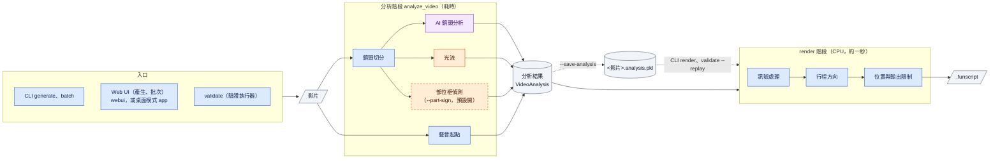
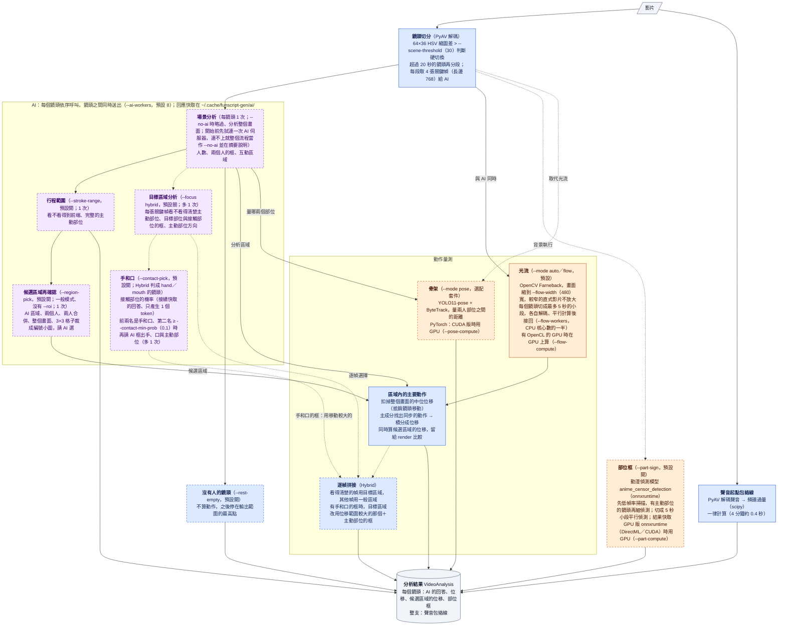

# 系統流程圖

從影片到 `.funscript` 的整個流程：有哪些元件、每一步做了什麼、哪些可以選擇，以及哪些用到 AI、GPU、CPU。功能與參數的說明在 [README.zh.md](README.zh.md)，設計的理由在 [PLAN.md](PLAN.md)（實驗數字在 [docs/archive/PLAN-archive.md](docs/archive/PLAN-archive.md)），開發與驗證在 [DEVELOPMENT.md](DEVELOPMENT.md)。

圖用 Mermaid 繪製，GitHub 與 VS Code（Markdown Preview Mermaid Support 等擴充）會直接顯示成圖。

**圖例**

| 顏色／框線 | 意義 |
|---|---|
| 紫色 | AI：視覺語言模型（自建的 vLLM 或 Ollama，預設 Qwen3-VL-8B），在 AI 主機的 GPU 上執行；本機只送出請求 |
| 橘色 | 本機 GPU 或 CPU：依「運算裝置」設定（`--compute` 與各步驟的 `--*-compute`，預設 Auto＝有可用的 GPU 就用） |
| 藍色 | 本機 CPU |
| 灰色 | 資料與檔案 |
| 虛線框 | 可以選擇的步驟（標示預設開或關） |

---

## 1. 整體

處理分成兩個階段：**分析**（解碼影片、呼叫 AI、算光流，耗時）與 **render**（訊號處理、方向判斷、輸出設定，約一秒）。只改輸出設定時沿用分析，不必重新解碼與呼叫 AI。

- 哪些設定屬於分析、哪些屬於 render，由 `options.py` 選項表的 `stage` 決定；改了分析設定就要重新分析（`render` 會拒絕）。
- Web UI 有兩種啟動方式：`webui`（可開放區網，影片一律上傳）與桌面模式 `app`（只限本機，「產生」「批次」「預覽」都不上傳，直接用檔案的路徑——拖放、原生選檔對話框或貼上；預覽可自動帶入同名的影片或 funscript，並可把腳本另存到影片旁邊；`app.py` 在 pywebview 視窗或瀏覽器中開啟同一個 Web UI）。Windows 免安裝版的 `FunscriptGen.exe` 是 `app`、`funscript-gen.exe` 是 CLI，兩者都用內附的 Python，檔案都寫在資料夾的 `data\`（`FUNSCRIPT_GEN_HOME`，`paths.py`）。
- 使用者看得到的文字（Web UI、預覽播放器、分析備註、錯誤訊息）來自語言包（`lang/*.toml`，`i18n.py`）；語言是整個程式的設定，Web UI 切換後即時更新所有元件，對流程的各步驟沒有影響。
- Web UI 對同一支影片只改輸出設定時，沿用記憶體中的分析（「批次」分頁的結果在「產生」分頁開啟後也是）；CLI 用 `generate --save-analysis` 存檔、`render` 重算；驗證執行器用 `--replay`。

---

## 2. 分析階段

鏡頭切分完成後，**AI、光流與部位框三者同時進行**：光流算整個畫面的位移場、不需要 AI 的回答（區域在讀取時才套用），部位框也不需要前兩者，所以都在背景先開始（使用 AI 時，部位框等場景分析回來，只偵測看得到人的鏡頭，空鏡頭不占 CPU）。

- AI 只負責「看懂畫面」（看哪裡、有沒有人、看不看得到主動部位），逐幀的位置由光流量測：AI 每次呼叫要數秒、數值定位不精確，而 funscript 需要每秒 10–30 個位置。
- 每個鏡頭的 AI 呼叫次數：一般模式 3 次（場景分析、行程範圍、候選區域），Hybrid 3 次（場景分析 2 次、行程範圍；不做候選區域），判成 hand／mouth 的鏡頭另外 1–2 次（接觸部位的機率很快，約 0.5 秒）。沒有人的鏡頭只做場景分析。
- 時間大致上：A04 沒有快取時 AI 64 秒、光流 26 秒，兩者同時進行；B03 在 CPU 上開部位框 119 秒、不開 81 秒（部位框和光流、AI 同時執行之前是 158 秒）。部位框每幀 CPU 約 100 ms、RTX 3070 的 DirectML 約 23 ms，兩者的框完全相同。

---

## 3. render 階段

全部在 CPU 上，不解碼影片、不呼叫 AI，所以可以換輸出設定重算，Web UI 的手動反轉也只重跑最後一步。

```mermaid
flowchart TB
    VA[("分析結果<br/>VideoAnalysis")]:::data

    RG["<b>行程範圍的上下限</b>（--stroke-range）<br/>看不到前端 → 截到 --range-cap（80）<br/>看得到前端但主動部位不完整 → 提高到 --range-floor（20）<br/>（在最後的範圍截斷套用）"]:::cpuOpt

    subgraph SIGBOX["訊號處理（每個鏡頭）"]
        direction TB
        S1["重新取樣到 --fps（30）"]:::cpu
        S2["<b>節奏濾波</b>（--rhythm-filter，預設開；只用於光流）<br/>頻譜集中在單一節奏時，以節奏的 0.5–2 倍帶通濾波"]:::cpuOpt
        S3["Hampel 去離群 → Savitzky-Golay 平滑<br/>（節奏濾波過 0.2 秒，其他 0.15 秒）<br/>局部範圍（百分位數）"]:::cpu
        S4["<b>轉折點</b><br/>交替的高低點，去掉太小（--min-prominence）或太快的行程"]:::cpu
        S1 --> S2 --> S3 --> S4
    end

    PICK["<b>候選區域比較</b>（--region-pick）<br/>AI 選的區域節奏不比原本的弱才換"]:::cpuOpt

    subgraph DIRBOX["行程方向（預設：往上動＝位置變高）"]
        direction TB
        D1["<b>長鏡頭分段方向一致</b>（--chunk-align，預設開）<br/>以方向最明確的一段為準，動作型態相同的分段跟著對齊"]:::cpuOpt
        D2["<b>依部位框</b>（--part-sign，預設開）<br/>主動部位與對象部位的距離變化和動作相反 → 反轉"]:::cpuOpt
        D3["<b>依行程快慢</b>（--asym-sign，預設開）<br/>往上明顯比往下快 → 反轉<br/>聲音沒有反對（起點不在低點）時門檻降低（--asym-audio，預設開）"]:::cpuOpt
        D4["<b>可能高低相反的提示</b><br/>只寫進鏡頭表的備註，不反轉"]:::cpu
        D1 --> D2 --> D3 --> D4
    end

    subgraph POSBOX["位置（每個鏡頭）"]
        direction TB
        P1["<b>幅度</b>：整支影片共用的滿行程基準<br/>--amplitude preserve（預設）／fill、--gain<br/>--scene-center（實驗性，預設關）<br/>對應到 --range-low～--range-high"]:::cpu
        P2["<b>高頻縮小幅度</b>（--freq-limit 2 Hz 起，預設開）"]:::cpuOpt
        P3["<b>停頓與補點</b>（--dwell、--curve，預設關）"]:::cpuOpt
        P1 --> P2 --> P3
    end

    FIN["<b>整支輸出</b><br/>手動反轉（--flip-scenes、--invert、Web UI 的「反轉」）<br/>鏡頭切換處接不上節奏時複製一次前一個行程（--bridge，預設開）<br/>沒有人的鏡頭停在最高點 → 行程範圍截斷<br/>→ 限速（--max-speed 500）→ 停頓保持（--hold，預設關）"]:::cpu

    OUT[/".funscript<br/>metadata 記錄版本、程式碼雜湊、AI 模型與全部設定"/]:::data
    DBG[/"--debug：.debug.json、.debug.png<br/>Web UI：訊號圖、鏡頭表、預覽播放器"/]:::data

    VA --> RG --> SIGBOX --> PICK --> DIRBOX --> POSBOX --> FIN --> OUT
    FIN --> DBG
    DBG -.->|"Web UI 按「反轉」只重跑這一步"| FIN

    classDef ai fill:#f3e8ff,stroke:#7e22ce,color:#3b0764
    classDef aiOpt fill:#f3e8ff,stroke:#7e22ce,color:#3b0764,stroke-dasharray:5 4
    classDef hw fill:#ffedd5,stroke:#c2410c,color:#431407
    classDef hwOpt fill:#ffedd5,stroke:#c2410c,color:#431407,stroke-dasharray:5 4
    classDef cpu fill:#dbeafe,stroke:#1d4ed8,color:#172554
    classDef cpuOpt fill:#dbeafe,stroke:#1d4ed8,color:#172554,stroke-dasharray:5 4
    classDef data fill:#f1f5f9,stroke:#475569,color:#0f172a
```

---

## 4. 元件一覽

| 元件 | 用到的套件／模型 | 在哪裡執行 | 可選擇？（預設） | 程式 |
|---|---|---|---|---|
| 解碼 | PyAV（精確時間戳） | CPU | 必要 | `video/decoder.py` |
| 鏡頭切分 | OpenCV（HSV 縮圖差） | CPU | 必要；`--scene-threshold` 調靈敏度 | `video/scenes.py` |
| 場景分析 | Qwen3-VL-8B（vLLM 等 OpenAI 相容 API，或 Ollama 原生 API：`VLLM_BACKEND`） | **AI**（AI 主機的 GPU） | `--ai/--no-ai`（開） | `ai/`、`pipeline.plan_scenes` |
| 目標區域分析 | 同上 | **AI** | `--focus hybrid`（關） | `ai/prompts.py` |
| 行程範圍 | 同上 | **AI** | `--stroke-range`（開） | `pipeline._detect_ranges` |
| 候選區域再確認 | 同上 | **AI**（比較在 CPU） | `--region-pick`（開，一般模式） | `ai/regions.py` |
| 沒有人的鏡頭停在最高點 | 場景分析的回答 | CPU | `--rest-empty`（開） | `pipeline.plan_scenes` |
| 光流 | OpenCV Farneback | **GPU**（OpenCL）或 CPU，`--flow-compute`；鏡頭切成 5 秒小段平行 | `--mode auto／flow`（預設） | `tracking/flow.py` |
| 骨架 | YOLO11-pose + ByteTrack（PyTorch） | **GPU**（CUDA 版 PyTorch）或 CPU，`--pose-compute` | `--mode pose`（關，選配套件 `--extra pose`） | `tracking/pose.py` |
| 部位框 | deepghs anime_censor_detection（onnxruntime） | **GPU**（GPU 版 onnxruntime；Windows 預設安裝 DirectML 版）或 CPU，`--part-compute` | `--part-sign`（開） | `tracking/parts.py` |
| 聲音起點 | PyAV、scipy | CPU | 一律計算；`--asym-audio`（開）決定是否使用 | `signal/audio.py` |
| 訊號處理、方向、位置 | numpy、scipy | CPU | 各步驟見第 3 節 | `signal/process.py`、`pipeline.render` |
| funscript 輸出 | — | CPU | — | `export/funscript.py` |

本機的 GPU 用在光流、部位框與骨架三個步驟（`devices.py`）。「運算裝置」設定（Web UI 在「設定」分頁）有整體的 `--compute` 與每個步驟的 `--flow-compute`、`--part-compute`、`--pose-compute`，選項都是 Auto／GPU／CPU、預設 Auto：步驟選 Auto 時依照整體，整體的 Auto 有可用的 GPU 就用、沒有就用 CPU；選 GPU 但找不到可用的 GPU 時，在解碼之前停止並提示原因。光流的 GPU 是 OpenCV 內建的 OpenCL（只需要顯示卡驅動程式）；部位框在 Windows 上預設安裝 DirectML 版的 onnxruntime（任何 DirectX 12 顯示卡），Linux 要另外裝 GPU 版；骨架要另外裝 GPU 版的 PyTorch（Windows 免安裝版不含骨架模式）。解碼、鏡頭切分、聲音與 render 留在 CPU：硬體解碼（NVDEC、D3D11VA）的畫面和 CPU 相同，但小段解碼時比 CPU 慢。AI 一律送到 `.env` 設定的 AI 主機（vLLM 或 Ollama，`config.make_provider` 依 `VLLM_BACKEND` 選 `ai/openai_compat.py` 或 `ai/ollama.py`）。換成 GPU 版的方法見 README 的「安裝」。
